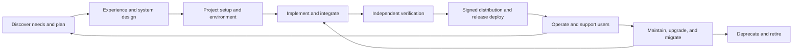

# Software lifecycle: how the 14 kk- skills are organized

These skills cover software work from an idea through retirement. There are **14 skills: 1 coordinating entry point, 10 phase skills, and 3 cross-cutting quality skills**. Phases can run in parallel and can iterate. The number of skills does not mean a project has met a quality bar.

## Responsibilities and handoffs

| Layer / phase | Skill | Concrete evidence handed to the next step |
|---|---|---|
| Lifecycle coordination | [kk-software-lifecycle](../kk-software-lifecycle/SKILL.md) | Current phase, gaps, the next piece of work, acceptance evidence, and unresolved ownership |
| Discover needs, plan, and check feedback | [kk-product-spec](../kk-product-spec/SKILL.md) | User problem, facts and assumptions, scope, acceptance examples, delivery slices, and the effect after launch |
| Interaction and experience design | [kk-experience-design](../kk-experience-design/SKILL.md) | User paths, states and recovery, content, accessibility requirements, prototypes, and validation results |
| System and data design | [kk-architecture-design](../kk-architecture-design/SKILL.md) | Domain boundaries, API/data contracts, failure behavior, tradeoffs, and compatibility strategy |
| Dev environment and project setup | [kk-project-bootstrap](../kk-project-bootstrap/SKILL.md) | Reproducible toolchain, dependencies, dev commands, commit checks, and CI |
| Infrastructure and runtime environment | [kk-platform-infrastructure](../kk-platform-infrastructure/SKILL.md) | Environment isolation, config and secret boundaries, change plan, state management, and actual verification |
| Coding, debugging, refactoring, and integration | [kk-ai-implementation](../kk-ai-implementation/SKILL.md) | Reviewable changes, regression evidence, the final integrated version, and docs kept in sync |
| Testing and code quality (cross-cutting) | [kk-software-verification](../kk-software-verification/SKILL.md) | Tests that match acceptance, an independent correctness review, and evidence for performance, accessibility, and failure paths |
| Security and privacy (cross-cutting) | [kk-security-review](../kk-security-review/SKILL.md) | Threat paths, permission and data boundaries, supply-chain controls, negative tests, and residual risk |
| AI product evaluation (cross-cutting when needed) | [kk-ai-evaluation](../kk-ai-evaluation/SKILL.md) | Versions of model/prompt/retrieval/tools, an independent evaluation, quality/cost/latency, and fallback conditions |
| Release and deploy | [kk-release-delivery](../kk-release-delivery/SKILL.md) | A signed artifact that is identified, release entry criteria, rollout and promotion conditions, and compatibility and recovery plans |
| Packaging, signing, and distribution | [kk-distribution](../kk-distribution/SKILL.md) | Signed packages for macOS, Windows/Chocolatey, and Linux, client-side verification, and channel availability |
| Operate, support, and handle incidents | [kk-production-ops](../kk-production-ops/SKILL.md) | User-facing metrics, support ownership, alerts, runbooks, recovery drills, and capacity/cost |
| Maintain, upgrade, migrate, and retire | [kk-software-evolution](../kk-software-evolution/SKILL.md) | Old/new compatibility, data reconciliation, migration progress, deprecation schedule, and evidence that data and resources have exited |

## Main flow and feedback

`kk-software-lifecycle` coordinates work that crosses phases. Security, quality, documentation, and AI-engineering constraints run through the phases they apply to. Design feedback can change requirements or architecture. Incidents and real usage feed back into fixes, design, and requirements.

**Signing is always a distribution requirement.** A successful build, a correct checksum, a successful upload, store review approval, and a user being able to install are different states. Every artifact intended for distribution must be signed and verified. Do not publish the other platforms early because one platform failed, unless the user explicitly narrows this release.

## Boundaries that are easy to mix up

- The product skill answers "what problem is solved, and how to tell it is valuable." The experience skill answers "how the user understands and completes the task." The architecture skill answers "how the system implements that behavior and holds its constraints."
- Bootstrap owns the repository and the dev/CI tools. Infrastructure owns the real runtime environment, resources, state, and configuration. Release owns promoting a determined version into the target environment.
- The implementation skill changes code. The verification skill independently proves behavior. The security skill owns concrete attacks and trust boundaries. One task can have one primary skill and other skills alongside it.
- Distribution owns package format, signing, install and update, and channels. Release owns the overall release decision, deployment, and recovery. Release entry criteria must include the distribution verification result.
- Ordinary software written with AI uses the implementation, verification, and security flow. Use the AI evaluation skill when the product itself includes a model, retrieval, or agent behavior.

## How to accept "covers the whole lifecycle"

On a real project, every relevant phase needs an owning skill, work that can be carried out, an artifact that can be checked, and a handoff to the next step. Documentation, support, maintenance, and retirement cannot be ownerless. Check those conditions against the [end-to-end execution contract](../kk-software-lifecycle/references/end-to-end.md).

Application type and task scope decide which phases apply. A service needs deploy and operations. A desktop app needs platform signing and upgrades. A library or CLI needs consumer install and compatibility verification. A local tool may mark cloud infrastructure "not applicable" and give a reason. A spelling fix does not need the whole flow.

What is provided now is lifecycle guidance. Framework and API specifics still have to follow the project's version and the official docs. Safety-critical work, unusual hardware, industry regulation, or specialized scientific training may need an additional expert. Passing a structural check does not mean the target software is launched, compliant, or reliable. Actual checks and items not yet run are in the [evaluation record](evaluation-results.md).
