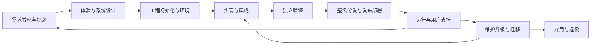

# 软件全生命周期：14 个 kk- 技能的组织与关系

这套技能面向软件从想法到退役的完整工作流程。当前是 **14 个技能：1 个协调入口，10 个阶段技能，3 个贯穿质量技能**。阶段可以并行和迭代；技能数量不代表项目已经达到质量标准。

## 职责与交接

| 层次 / 阶段 | 技能 | 交给下一步的实际证据 |
|---|---|---|
| 全流程协调 | [kk-software-lifecycle](../kk-software-lifecycle/SKILL.md) | 当前阶段、缺口、下一项工作、验收证据和未解决责任 |
| 发现需求、规划、反馈验证 | [kk-product-spec](../kk-product-spec/SKILL.md) | 用户问题、事实与假设、范围、验收例子、交付切片、上线后的效果 |
| 交互与体验设计 | [kk-experience-design](../kk-experience-design/SKILL.md) | 用户路径、状态与恢复、内容、无障碍要求、原型与验证结果 |
| 系统与数据设计 | [kk-architecture-design](../kk-architecture-design/SKILL.md) | 领域边界、API/数据契约、失败行为、取舍和兼容策略 |
| 开发环境与工程初始化 | [kk-project-bootstrap](../kk-project-bootstrap/SKILL.md) | 可复现工具链、依赖、开发命令、提交检查和 CI |
| 基础设施与运行环境 | [kk-platform-infrastructure](../kk-platform-infrastructure/SKILL.md) | 环境隔离、配置与密钥边界、变更计划、状态管理和实际验证 |
| 编码、调试、重构与集成 | [kk-ai-implementation](../kk-ai-implementation/SKILL.md) | 可审查的变更、回归证据、最终集成版本和同步文档 |
| 测试与代码质量（贯穿） | [kk-software-verification](../kk-software-verification/SKILL.md) | 验收对应的测试、独立正确性审查、性能/无障碍和失败路径证据 |
| 安全与隐私（贯穿） | [kk-security-review](../kk-security-review/SKILL.md) | 威胁路径、权限与数据边界、供应链控制、负向测试和剩余风险 |
| AI 产品评估（按需贯穿） | [kk-ai-evaluation](../kk-ai-evaluation/SKILL.md) | 模型/提示词/检索/工具的版本、独立评估、质量/成本/延迟与回退条件 |
| 发布与部署 | [kk-release-delivery](../kk-release-delivery/SKILL.md) | 确定的签名产物、发布准入、灰度与晋级条件、兼容和恢复方案 |
| 打包、签名与分发 | [kk-distribution](../kk-distribution/SKILL.md) | macOS、Windows/Chocolatey、Linux 的签名包、客户端验证和渠道可用性 |
| 运行、支持与事故处理 | [kk-production-ops](../kk-production-ops/SKILL.md) | 用户侧指标、支持责任、告警、运行手册、恢复演练和容量/成本 |
| 维护、升级、迁移与退役 | [kk-software-evolution](../kk-software-evolution/SKILL.md) | 新旧兼容、数据核对、迁移进度、弃用安排、数据与资源退出证据 |

## 主流程与反馈关系

`kk-software-lifecycle` 协调需要跨阶段的任务；安全、质量、文档和 AI 工程约束贯穿相关阶段。设计反馈可以改变需求或架构，事故和使用效果会回到修复、设计及需求工作。

**签名始终是分发要求。** 构建成功、校验和正确、上传成功、商店审核通过、用户可安装是不同状态。所有拟分发产物必须签名并验证；不能因为其中一个平台失败就提前发布其余平台，除非用户明确缩小本次发布范围。

## 容易混淆的边界

- 产品技能回答“解决什么问题、如何判断有价值”；体验技能回答“用户如何理解和完成任务”；架构技能回答“系统如何实现这些行为并维持约束”。
- Bootstrap 负责仓库和开发/CI 工具；基础设施负责实际运行环境、资源、状态和配置；发布负责将确定版本晋级到目标环境。
- 实现技能负责改代码；验证技能负责独立证明行为；安全技能负责具体攻击与信任边界。一次任务可以由一个主技能配合其他技能完成。
- 分发负责包格式、签名、安装更新和渠道；发布负责整体发布决策、部署与恢复。发布准入必须包含分发验证结果。
- AI 写出的普通软件使用实现、验证和安全流程；产品本身包含模型、检索或智能体行为时，再使用 AI 评估技能。

## “覆盖全流程”的验收方式

针对实际项目，每个相关阶段必须有责任技能、可执行工作、可检查产物和下一步交接；文档、支持、维护和退役不能成为无主事项。使用 [端到端执行规范](../kk-software-lifecycle/references/end-to-end.md) 核对这些条件。

应用类型和任务范围决定哪些阶段适用：服务需要部署和运营，桌面应用需要平台签名与升级，库/CLI 需要消费者安装与兼容验证，本地工具可以有理由地标记云基础设施为“不适用”。一个拼写修复不需要执行整套流程。

当前提供的是全流程工作指导；具体框架/API 仍需结合项目版本和官方文档。安全关键、特殊硬件、行业法规或专业科学训练任务可能需要额外专家。结构校验通过不等于目标软件已经上线、合规或可靠；实际检查和未执行项见 [评估记录](evaluation-results.md)。
